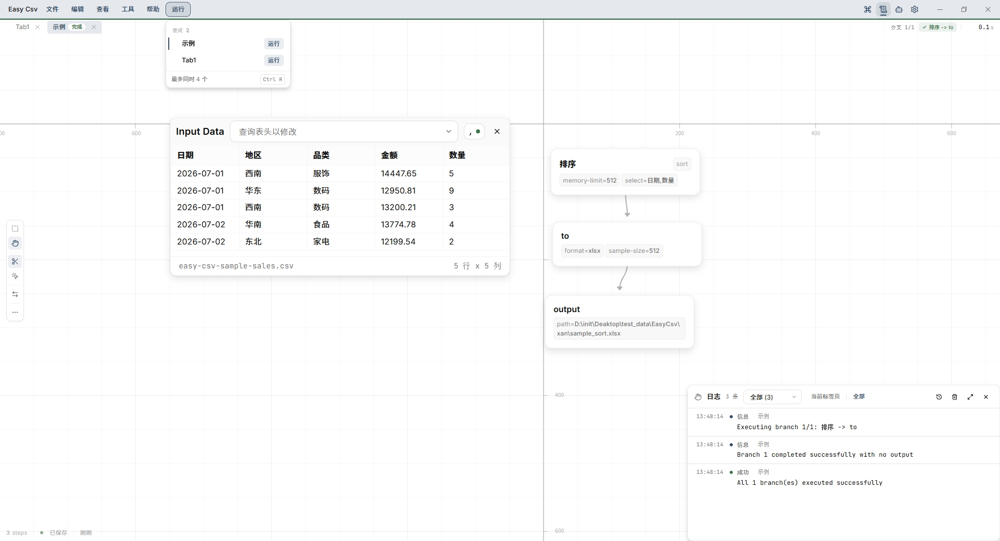
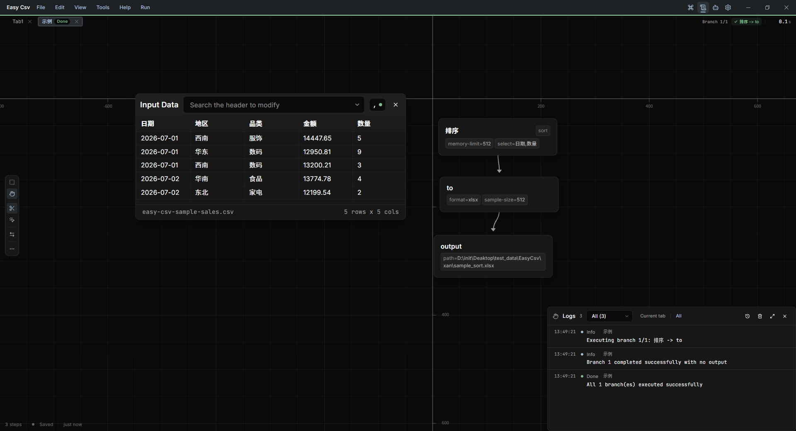

# Easy Csv

**English** | [简体中文](README_ZH.md)

Handle CSV data in a modular way - chain [xan](https://github.com/medialab/xan) commands together like building blocks in a visual pipeline, without leaving your desktop.

Built with [Tauri](https://tauri.app/) v2 + React 19 + React Flow, and powered by [xan](https://github.com/medialab/xan) as the underlying CSV toolkit.

## Contents

- [Screenshots](#screenshots)
- [Download and install](#download-and-install)
- [Features](#features)
- [Prerequisites](#prerequisites)
- [Build from source](#build-from-source)
- [Development](#development)
- [Building](#building)
- [Testing](#testing)
- [Usage](#usage)
  - [Keyboard shortcuts](#keyboard-shortcuts)
- [AI Assistant](#ai-assistant)
- [Documentation](#documentation)
- [License](#license)

## Screenshots





## Download and install

Grab the file for your platform from the [latest release](https://github.com/tansen87/easy-csv/releases/latest) - every asset carries its version in the name, so pick the row that matches your machine.

| Platform | Download | How to install |
|----------|----------|----------------|
| **Windows 10/11 (x64)** | `EasyCsv_<version>_x64-setup.exe` | Double-click and follow the wizard. It installs per-user into `%LOCALAPPDATA%\EasyCsv` - no administrator rights, no UAC prompt. SmartScreen may warn about an unrecognised app on first run: **More info → Run anyway**. |
| **macOS (Apple silicon)** | `EasyCsv_<version>_aarch64.dmg` | Open the dmg and drag **EasyCsv** into **`~/Applications`** (your home folder, not the system-wide `/Applications`). That is what keeps in-app updates working without a password prompt. |
| **macOS (Intel)** | `EasyCsv_<version>_x64.dmg` | Same as above, with the Intel build. |
| **Linux (x64, portable)** | `EasyCsv_<version>_amd64.AppImage` | `chmod +x EasyCsv_*_amd64.AppImage && ./EasyCsv_*_amd64.AppImage`. The AppImage is the only Linux form that can update itself in place. |
| **Linux (x64, Debian/Ubuntu)** | `EasyCsv_<version>_amd64.deb` | `sudo apt install ./EasyCsv_*_amd64.deb` (or `sudo dpkg -i`). Installed this way, in-app updates are off - download new versions from the releases page instead. |

Notes:

- **Install `xan` on first launch.** EasyCsv has no bundled CSV engine; it asks you to install the `xan` plugin once, from **Settings → Plugins**, with a single click. The app verifies the manifest signature and the asset's `sha256` before it installs anything.
- **In-app updates** are fetched from GitHub Releases, verified against a signing key, and installed over the running install without touching your data. They work for the Windows installer, a macOS app in `~/Applications`, and the Linux AppImage; they are disabled for the `.deb` and for a macOS app in `/Applications` (see the table).
- **Not sure which files are for you?** `*.sig` and `latest.json` are updater metadata, and the `.app.tar.gz` assets are macOS update payloads - you never download those by hand.

## Features

- **Visual pipeline editor** - drag, connect and configure xan commands on a node canvas (dagre auto-layout, cut/fall animations, undo/redo, copy/paste, tidy / fit / zoom / lock tools, left-button select or pan, mouse-button swap)
- **61 built-in xan commands** - from basic `sort` / `filter` / `select` to `pivot`, `window`, `join`, `stats`, `split`, `partition`, `to` / `from` conversion and more, each with a dedicated configuration dialog
- **Column quick actions** - right-click any header for search, empty-value handling (only / exclude / fill / blank repeated runs), deduplicate by column, text and number transforms, replace, date parsing, group aggregates, top N, pivot / window, and column actions (copy name or values, rename, delete, keep only); one-click actions land as pipeline steps
- **Cleaning and conversion tools** - split bad rows, clean special characters, convert encoding, split by row count, enumerate within groups, CSV → Excel, merge workbooks, and diff two CSVs
- **Charts** - line, scatter, bar, histogram, pie, heatmap and word-cloud views, with SVG export
- **AI assistant** - describe what you want in natural language (Chinese/English), and the assistant generates ready-to-insert pipeline steps via DeepSeek / Qwen / GLM, with saved conversation sessions (history list, rename, delete) and RAG over per-command docs
- **Expression editor** - syntax highlighting and autocomplete for 200+ [Moonblade](https://github.com/medialab/xan) functions
- **Batch search** - split one CSV into many files by column value, plus batch format conversion (CSV ↔ XLSX ↔ JSON)
- **Data profiling** - one-click column statistics (count, nulls, min/max/mean, etc.) via `xan stats`
- **Built-in templates** - the template library ships with starting points (a runnable sample pipeline, quick clean-up, profiling, grouping, sort + top N)
- **Pipeline versioning** - save / restore / delete pipeline versions with tags
- **Data lineage** - track how columns transform through your pipeline
- **Run status and execution log** - a progress rail along the canvas top and an elapsed-time readout in the tab row, with cancel; the log panel opens automatically and keeps per-step output
- **Bilingual UI** - English / Chinese / system language, plus dark/light/system themes

## Prerequisites

- [Node.js](https://nodejs.org/) (v18 or higher)
- [pnpm](https://pnpm.io/)
- [Rust](https://www.rust-lang.org/) toolchain (1.94 or higher)

## Build from source

1. Provide an `xan` binary for local development: put `xan.exe` in `src-tauri/resources/plugins/windows-x86_64/` (the app also looks on `PATH`). Release installers do not bundle it - users install `xan` once from **Settings → Plugins**. You can build it with `cargo build --release` from the [xan](https://github.com/medialab/xan) source, or download a pre-built binary from [xan releases](https://github.com/medialab/xan/releases).
2. Install project dependencies:

```bash
pnpm install
```

## Development

```bash
pnpm tauri dev
```

## Building

```bash
pnpm tauri build
```

## Testing

```bash
pnpm test        # run the vitest suite
pnpm test:watch  # watch mode
```

## Usage

1. **Open a CSV** - drag & drop a file onto the window, or use `Ctrl+O`. Nothing to hand yet? Click **See an example** on the welcome screen for a sample dataset plus a pipeline that already runs.
2. **Add a step** - press `Alt+C` for the command panel (it is hidden by default) and click any of the 61 xan commands; or **right-click a column header** for quick actions such as search, fill empty cells, deduplicate by that column, or group aggregates. Press `Alt+A` to describe what you need and let the assistant build the step.
3. **Pipelines and branches** - a new step becomes **its own branch** and applies straight to the input, so it runs without being connected. To chain two steps, **right-press on an operation node** and drag onto the target (the connection must start on an operation node; the canvas's gesture card lists the rest).
4. **Configure parameters** - click the gear icon on a step card, or double-click the node.
5. **Execute** - press `Ctrl+R`. A progress rail runs along the canvas top, while the tab row reports the current branch, step and elapsed time with a cancel action. The log panel opens automatically when a run starts and holds every step's output.
6. **Export** - add a `to` or `output` step to write results to disk. `Ctrl+S` / `Ctrl+E` save and export the pipeline itself, and the template library (`Ctrl+T`) ships with built-in starting points.

### Keyboard shortcuts

| Shortcut | Action |
|----------|--------|
| `Ctrl+O` / `Ctrl+N` | Open file / open file in new tab |
| `Ctrl+S` / `Ctrl+E` | Save / export pipeline |
| `Ctrl+I` | Import pipeline |
| `Ctrl+T` | Template library |
| `Ctrl+Z` / `Ctrl+Y` | Undo / redo |
| `Ctrl+R` | Execute pipeline |
| `F5` | Refresh input file |
| `Shift+H` / `Shift+C` / `Shift+S` | Help / check update / settings |
| `Alt+C` / `Alt+Q` / `Alt+A` | Commands / logs / AI panel |

## AI Assistant

Configure your provider and API key in **Settings → AI** (`Shift+S`).

Supported providers:

| Provider | Model examples |
|----------|----------------|
| DeepSeek | `deepseek-v4-flash`, `deepseek-v4-pro` |
| Qwen | `qwen-turbo`, `qwen-max`, `qwen3.7-plus` |
| GLM | `glm-4.7-flash`, `glm-4-flash-250414`, `glm-4-flash` |

The assistant keeps each conversation as a session: open the history list from the AI panel to switch, rename, or delete one, and follow-up messages are answered with that session's context. Generated commands are automatically connected to the last step in your pipeline.

## Documentation

- [docs/AI/INDEX.md](docs/AI/INDEX.md) - full architecture and codebase index (Rust backend, frontend, hooks, components, how to modify each area)
- [docs/AI/USAGE.md](docs/AI/USAGE.md) - merged usage docs for the bundled xan commands
- [src/docs/AI_usage/](src/docs/AI_usage) - generated per-command docs (source: `pnpm run generate-ai-usage`)
- [src/docs/cmd/](src/docs/cmd) - per-command help docs (English)
- [docs/cmd_zh/](docs/cmd_zh) - per-command help docs (Chinese)

## License

MIT
